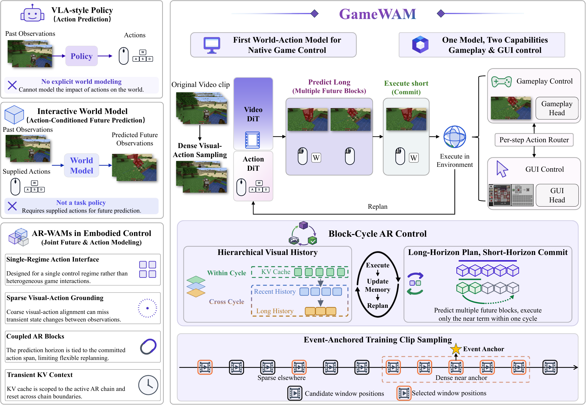
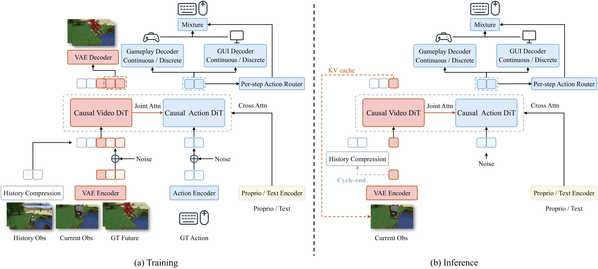
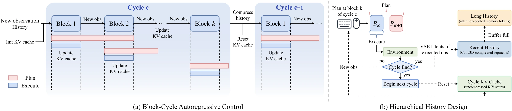

<h1 align="center">GameWAM:<br>A World Action Model for Video Games</h1>

<p align="center">
  <strong>Yuncheng Guo<sup>1</sup>, Zhanqiu Zhang<sup>2,†</sup>, Yiwen Guo<sup>3,†</sup>, Weijia Li<sup>4,†</sup></strong>
  <br>
  <sup>1</sup>Fudan University &nbsp;·&nbsp; <sup>2</sup>LIGHTSPEED &nbsp;·&nbsp; <sup>3</sup>Independent Researcher &nbsp;·&nbsp; <sup>4</sup>Tsinghua Shenzhen International Graduate School
  <br>
  <sup>†</sup>Corresponding authors
</p>

<p align="center">
  <a href="https://yunncheng.github.io/GameWAM/"></a>
  <a href="https://arxiv.org/abs/2608.26200"></a>
  <a href="https://huggingface.co/Yunncheng/gamewam-models"></a>
  <a href="https://huggingface.co/datasets/Yunncheng/gamewam-minecraft"></a>
  <a href="https://huggingface.co/datasets/Yunncheng/gamewam-vizdoom"></a>
</p>

<p align="center">
  <a href="https://yunncheng.github.io/GameWAM/">
    
  </a>
</p>

## Overview

Modern video games combine rapidly changing first-person observations, persistent world state, and heterogeneous native controls. Existing game agents map visual and task context directly to actions but lack explicit world-dynamics modeling, while interactive game world models predict visual futures from supplied actions but do not directly serve as task policies.

GameWAM bridges these two directions. To our knowledge, it is the first **World Action Model for native closed-loop gameplay and GUI control**. GameWAM jointly generates future visual observations and executable keyboard–mouse trajectories through parallel visual and action generative processes with block-causal conditioning and flow matching. During online control, it predicts beyond the committed action horizon, executes only a short prefix, observes the resulting environment state, and replans.

## Highlights

- **A World Action Model for games.** GameWAM jointly generates future visual observations and executable native actions using parallel Video and Action DiTs, block-causal attention, and joint flow matching.
- **Unified heterogeneous native control.** Continuous camera or cursor motion and concurrent discrete controls share one Action-DiT flow. A learned per-action router selects gameplay- or GUI-specific predictions and continuous-action normalization at every action timestep.
- **Long-horizon block–cycle control.** Each planning unit predicts beyond the committed horizon, executes only a short action prefix, and replans from new observations. A bounded within-cycle KV cache and hierarchical cross-cycle visual history preserve temporal continuity under bounded memory.
- **Competitive closed-loop performance.** Across Minecraft and ViZDoom, GameWAM achieves competitive task performance; in Minecraft, it uses fewer executed native actions than the compared agents across all evaluated task categories.
- **Low-Frequency Action Source Imprinting.** We uncover LASI, a source-sensitivity failure mode in which low-frequency components of the sampled action source steer coarse generated camera motion and can accumulate into persistent directional bias when reused across replanning steps.

## Method

GameWAM models visual futures and native actions with parallel causal Video and Action DiTs. Visual, instruction, proprioceptive, and historical conditions are integrated through block-causal interaction, while the action process directly generates executable keyboard–mouse trajectories. For heterogeneous game interaction, gameplay and GUI control retain one physical action layout but use mode-specific prediction distributions and continuous-action statistics.

<p align="center">
  
</p>

### Block–cycle autoregressive control

Dense visual–action sampling captures rapid ego-motion, transient targets, and brief interaction events, but a fixed token and cache budget then covers less interaction time. GameWAM decouples prediction from commitment: each planning unit predicts a longer action horizon, commits only a shorter execution block, and replans after receiving new observations.

Within a cycle, a bounded KV cache preserves fine-grained context. Across cycle boundaries, recent executed observations remain explicitly represented while older information is compressed into long-term hierarchical history.

<p align="center">
  
</p>

## Evaluation Scope

We evaluate GameWAM on native closed-loop control in **Minecraft** and **ViZDoom**. The two environments cover different visual dynamics, task horizons, and native action spaces. We additionally include a diagnostic **Minecraft-to-VoxeLibre zero-shot evaluation** to study transfer without VoxeLibre fine-tuning. The paper provides the full benchmark tables, evaluation protocols, and experiment configurations.

## Low-Frequency Action Source Imprinting

Our closed-loop analysis reveals **Low-Frequency Action Source Imprinting (LASI)**. Under fixed conditioning, low-temporal-frequency components of the sampled action source can coherently steer coarse generated camera motion. Reusing the same source across replanning steps can accumulate this bias into persistent directional motion, including repeated in-place rotation. This behavior distinguishes LASI from ordinary sampling diversity and exposes a source-sensitivity failure mode specific to repeated generative control.

## Repository layout

```text
GameWAM/
├── assets/                         # README figures
├── configs/                        # Hydra model, data, task, and simulator configs
├── experiments/
│   ├── minecraft/                  # Minecraft multi-task evaluation
│   ├── vizdoom/                    # ViZDoom multi-map evaluation
│   └── voxelibre/                  # VoxeLibre zero-shot evaluation
├── run.sh                          # Precomputation, training, and evaluation commands
├── scripts/
│   ├── datasets/                   # Data download, conversion, and collection
│   ├── precompute/                 # Text embedding and VAE latent caches
│   ├── preprocess_action_dit_backbone.py
│   ├── train.py
│   └── train_zero{1,2}.sh
├── src/gamewam/
│   ├── datasets/                   # LeRobot datasets, processors, schemas, transforms
│   ├── envs/                       # Minecraft, ViZDoom, and VoxeLibre adapters
│   ├── models/                     # GameWAM, MoT, Wan2.2, ActionDiT, and history
│   ├── inference.py                # Closed-loop inference runtime
│   ├── runtime.py                  # Model/dataset construction and entry points
│   └── trainer.py                  # Distributed training and checkpointing
```

## Installation

GameWAM requires Linux, Git, Conda, Python 3.10 or newer, and a CUDA-capable PyTorch installation. Clone the repository and create the environment from the repository root:

```bash
git clone https://github.com/yunncheng/GameWAM.git
cd GameWAM

conda create -n gamewam python=3.10 -y
conda activate gamewam

pip install -U pip
pip install torch==2.7.1+cu128 torchvision==0.22.1+cu128 --extra-index-url https://download.pytorch.org/whl/cu128
pip install minestudio==1.1.6
pip install -e .

# Debian/Ubuntu
apt-get update && apt-get install -y xvfb ffmpeg openjdk-8-jdk
```

MineStudio, Xvfb, FFmpeg, and Java 8 support Minecraft evaluation and Scripted GUI collection. MineStudio installs Ray and OpenCV as dependencies; Ray supports parallel evaluation, while OpenCV is used by ViZDoom observation processing and the Minecraft VPT converters.

The evaluation wrappers store MineStudio assets in `<repository>/.minestudio`.
Set `MINESTUDIO_DIR` to use another location:

```bash
export MINESTUDIO_DIR=/path/to/.minestudio
```

Run the commands below from the repository root. ViZDoom APPO data collection
uses a separate Conda environment named `vizdoom_appo` to isolate its Sample
Factory and ViZDoom dependencies. VoxeLibre evaluation requires the additional
setup described in [VoxeLibre zero-shot evaluation](#voxelibre-zero-shot-evaluation).

Model and dataset artifacts are distributed separately from the source code.
Download released checkpoints from [GameWAM models](https://huggingface.co/Yunncheng/gamewam-models).
`checkpoints/` stores upstream model components and the generated ActionDiT
initialization checkpoint. Download each GameWAM checkpoint together with its
matching `dataset_stats.json`, then pass both paths to the evaluation wrapper.

## Data preparation

Minecraft training uses Event-Anchored VPT, regular VPT, and Scripted GUI
trajectories. ViZDoom training uses APPO trajectories from `battle1`, `battle2`,
`defend_the_center`, and `defend_the_line`. The Hydra data configurations define
dataset composition and sampling.

Download the released datasets from [GameWAM Minecraft](https://huggingface.co/datasets/Yunncheng/gamewam-minecraft)
and [GameWAM ViZDoom](https://huggingface.co/datasets/Yunncheng/gamewam-vizdoom).

See **[GameWAM Dataset Preparation](scripts/datasets/README.md)** for download,
conversion, and collection commands, together with the LeRobot layout and
metadata schemas.

Before precomputation or training, configure:

- [`configs/data_child_override/mc_vpt_event.yaml`](configs/data_child_override/mc_vpt_event.yaml), [`mc_vpt_contractor.yaml`](configs/data_child_override/mc_vpt_contractor.yaml), and [`mc_scripted_gui.yaml`](configs/data_child_override/mc_scripted_gui.yaml) for the Minecraft dataset and cache paths;
- [`configs/data/minecraft_mixed.yaml`](configs/data/minecraft_mixed.yaml) for Minecraft stream composition and sampling;
- [`configs/data/vizdoom.yaml`](configs/data/vizdoom.yaml) for the ViZDoom dataset and cache paths.

Replace the `/path/to/...` placeholders with your own locations.

## Quick start

After installing the environment, preparing the datasets, and configuring the
dataset and cache paths, use the top-level command entry point:

```bash
bash run.sh
```

`run.sh` collects the commands for text-embedding and VAE-latent precomputation,
training, and Minecraft, ViZDoom, and VoxeLibre evaluation. The following
sections document each stage and its options. Use the same Hydra task
configuration across precomputation, training, and evaluation.

## Initialize the ActionDiT backbone

GameWAM initializes ActionDiT from the Wan2.2 video backbone through a task-resolved preprocessing step:

```bash
python scripts/preprocess_action_dit_backbone.py \
  --task-config mc_uncond_ar_224_4e-5 \
  --output checkpoints/ActionDiT_linear_interp_Wan22_alphascale_1024hdim.pt
```

The script loads the model settings through the complete Hydra task, adapts compatible Video DiT weights to ActionDiT, and writes the initialization file referenced by [`configs/model/wan_uncond_ar.yaml`](configs/model/wan_uncond_ar.yaml). Run it on a machine with sufficient CPU memory.

Wan2.2 components are resolved under `./checkpoints/` by default. Set `DIFFSYNTH_MODEL_BASE_PATH` to use another local model root. Missing upstream components may be downloaded by the model loader unless `DIFFSYNTH_SKIP_DOWNLOAD=true` is set.

## Precompute dataset features

The training datasets consume cached text embeddings and VAE latents. Configure the paths first, then run the same task used for training.

### Minecraft

```bash
# Text embeddings
python scripts/precompute/text_embeds.py \
  task=mc_uncond_ar_224_4e-5

# VAE latents on multiple GPUs
GPUS=8
torchrun --standalone --nproc_per_node="$GPUS" \
  scripts/precompute/vae_latents.py \
  task=mc_uncond_ar_224_4e-5 \
  num_workers=8
```

### ViZDoom

```bash
python scripts/precompute/text_embeds.py \
  task=vizdoom_uncond_ar_224_2e-4

GPUS=8
torchrun --standalone --nproc_per_node="$GPUS" \
  scripts/precompute/vae_latents.py \
  task=vizdoom_uncond_ar_224_2e-4 \
  num_workers=8
```

Both precomputation scripts default to `overwrite=false`. Text files found at the expected prompt hashes are skipped; the VAE cache validates its existing index and binary layout, then encodes only missing entries.

## Training

Minecraft training with DeepSpeed ZeRO-2:

```bash
bash scripts/train_zero2.sh 8 \
  task=mc_uncond_ar_224_4e-5
```

ViZDoom training:

```bash
bash scripts/train_zero2.sh 8 \
  task=vizdoom_uncond_ar_224_2e-4
```

The first argument is the number of local training processes. Multi-machine settings are provided through `NNODES`, `NODE_RANK`, `MASTER_ADDR`, and `MASTER_PORT`. Runs are written beneath `runs/<task>/` and contain the resolved config, `dataset_stats.json`, weight checkpoints, Accelerate state, and evaluation artifacts.

W&B logging is enabled in online mode by default. Override it when required:

```bash
# Local W&B files without network upload
bash scripts/train_zero2.sh 8 \
  task=mc_uncond_ar_224_4e-5 \
  wandb.mode=offline

# Disable W&B
bash scripts/train_zero2.sh 8 \
  task=mc_uncond_ar_224_4e-5 \
  wandb.enabled=false
```

The reported Minecraft experiment used BF16, DeepSpeed ZeRO-2, 8×H200 GPUs,
a batch size of 44 per GPU, and two epochs (21,900 optimizer steps). The training
launcher also supports smaller local process counts through its first argument.

## Evaluation

Evaluation requires a checkpoint and its matching `dataset_stats.json`, and
validates both before rollout.

### Minecraft

```bash
bash scripts/eval_mc_multi.sh \
  --ckpt /path/to/gamewam-minecraft.pt \
  --dataset_stats /path/to/dataset_stats.json \
  --mode custom \
  --tasks "mine_block:oak_log" \
  --episodes 3 \
  --split 40 \
  --gpus_per_worker 0.2 \
  --output /path/to/evaluate_results/minecraft
```

- `--mode custom|mini|all` selects the task source.
- `--tasks` accepts comma-separated task names in custom mode.
- `--split N` controls evaluation parallelism: positive values spawn N Ray
  workers, while `--split 0` runs in the main process. With the default
  `--gpus_per_worker 0.2`, 8 H200 GPUs support `--split 40` and a single GPU
  supports `--split 5`, which is the fastest way to run full evaluations. Use
  `--split 0` or `--split 1` when measuring model inference speed and latency.
- `--gpus_per_worker` controls Ray GPU allocation per worker.
- Arguments after `--` are forwarded to `experiments/minecraft/eval_mc_multi.py`.
- The wrapper prepares the MineStudio engine non-interactively before starting workers.

### ViZDoom

```bash
bash scripts/eval_vizdoom_multi.sh \
  --ckpt /path/to/gamewam-vizdoom.pt \
  --dataset_stats /path/to/dataset_stats.json \
  --mode all \
  --episodes 50 \
  --split 40 \
  --gpus_per_worker 0.2 \
  --output /path/to/evaluate_results/vizdoom
```

Use `--mode custom --scenarios battle1,battle2` to select specific maps.
Results are reported independently per map using average cumulative episode
reward.

### VoxeLibre zero-shot evaluation

Install the native build dependencies on Ubuntu/Debian:

```bash
apt-get install -y --no-install-recommends \
  git cmake g++ make \
  libgl1-mesa-dev libsdl2-dev libfreetype-dev \
  libsqlite3-dev libjpeg-dev libzstd-dev
```

Then prepare the pinned Craftium/VoxeLibre environment:

```bash
bash scripts/setup_voxelibre_eval.sh
```

By default, the setup stores the pinned Craftium and VoxeLibre environment in
`.voxelibre` inside the repository. The evaluation wrapper resolves it
automatically. Temporary Minetest run directories are created under
`.voxelibre/runtime` and removed after each environment closes. To use another
root, set `VOXELIBRE_DIR` for both setup and evaluation:

```bash
export VOXELIBRE_DIR=/path/to/.voxelibre
bash scripts/setup_voxelibre_eval.sh
```

Then evaluate the Minecraft checkpoint without VoxeLibre fine-tuning:

```bash
bash scripts/eval_voxelibre_zero_shot.sh \
  --ckpt /path/to/gamewam-minecraft.pt \
  --dataset_stats /path/to/dataset_stats.json \
  --tasks all \
  --episodes 20 \
  --split 40 \
  --gpus_per_worker 0.2 \
  --output /path/to/evaluate_results/voxelibre_zero_shot
```

The wrapper follows the Minecraft multi-task evaluation setup and runs under
Xvfb. Use `--task_config` only to override the default task configuration
selected by `configs/sim_voxelibre.yaml`. The six fixed tasks measure
zero-shot transfer from Minecraft to VoxeLibre.

## Acknowledgments

We thank the authors of the following open-source projects; this work has
benefited from their ideas, code, and data releases:

- [Fast-WAM](https://github.com/yuantianyuan01/FastWAM)
- [DreamZero](https://github.com/dreamzero0/dreamzero)
- [VPT (Video PreTraining)](https://github.com/openai/Video-Pre-Training)
- [OpenHA](https://github.com/CraftJarvis/OpenHA)

## Citation

If you find GameWAM useful, please cite:

```bibtex
@misc{guo2026gamewamworldactionmodel,
      title={GameWAM: A World Action Model for Video Games},
      author={Yuncheng Guo and Zhanqiu Zhang and Yiwen Guo and Weijia Li},
      year={2026},
      eprint={2608.26200},
      archivePrefix={arXiv},
      primaryClass={cs.AI},
      url={https://arxiv.org/abs/2608.26200}
}
```