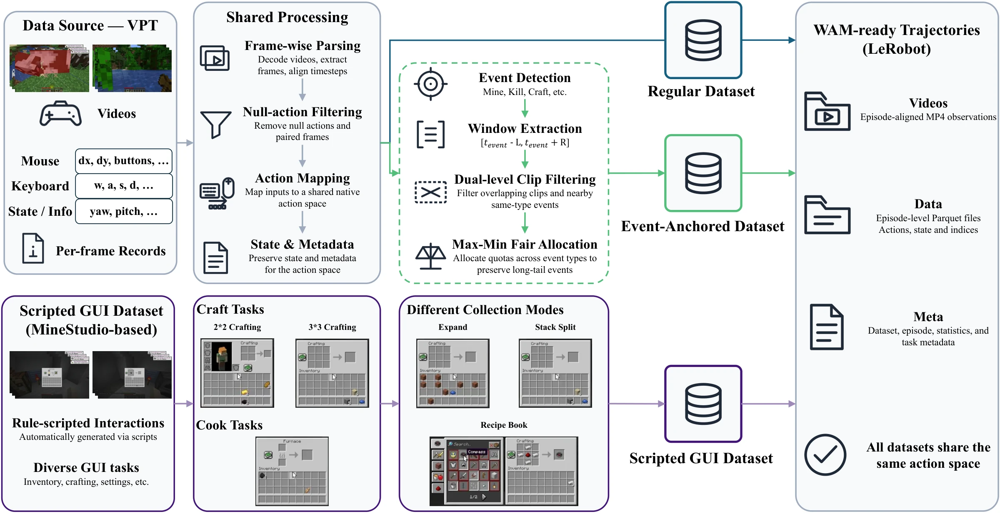

# GameWAM Dataset Preparation

[Back to the main README](../../README.md)

This directory contains the data download, conversion, and collection tools used
by GameWAM. The training pipeline consumes **LeRobot v2.1** datasets with aligned
video, state, action, and task metadata.

## Synchronized Gameplay and GUI Data

GameWAM training uses synchronized visual observations, native actions, state,
and task information. The Minecraft data pipeline standardizes gameplay
recordings into a shared keyboard–mouse action space, constructs event-anchored
clips around behaviorally informative transitions, and generates scripted GUI
interactions for crafting, smelting, and related inventory procedures. Each
source produces aligned training trajectories with a common action layout.

<p align="center">
  
</p>

## Pipeline

```text
public recordings or simulator rollouts
                |
                v
download / convert / collect
                |
                v
LeRobot v2.1 datasets (aligned video, state, action, and task metadata)
                |
                v
configure dataset and cache paths
                |
                v
precompute text embeddings and VAE latents
                |
                v
train GameWAM
```

Dataset artifacts are distributed separately from the source code. This guide
describes how to prepare them from the original data sources and simulators.

## Prerequisites

Run commands from the repository root unless noted otherwise.

- Use the `gamewam` Conda environment for Minecraft download/conversion and Scripted GUI collection.
- VizDoom APPO checkpoint preparation and collection use a separate Conda environment named `vizdoom_appo`; see [VizDoom APPO data](#vizdoom-appo-data) for its installation.

The shell files under this directory provide the reference presets used for
dataset preparation. Replace their `/path/to/...` placeholders with local paths
before running them.

## Output format

Converters and collectors write a LeRobot v2.1 dataset with this layout:

```text
/path/to/dataset/
├── meta/
│   ├── info.json
│   ├── tasks.jsonl
│   ├── episodes.jsonl
│   ├── stats.json
│   └── episodes_stats.jsonl
├── data/
│   └── chunk-000/
│       └── episode_000000.parquet
└── videos/
    └── chunk-000/
        └── observation.images/
            └── episode_000000.mp4
```

Each tabular row is aligned with its observation frame and action. The principal schemas are:

| Domain | Action | Raw state | Training representation |
|---|---:|---:|---|
| Minecraft | 22-D keyboard/mouse vector | 6-D state | 15-D canonical proprioception |
| VizDoom | 9-D canonical action | 4-D state | State plus validity/padding metadata |

Minecraft's raw state contains pitch, yaw, cursor x/y, current hotbar slot, and GUI-open state. The 22-D action contains camera pitch/yaw, movement keys, interaction keys, inventory, and nine hotbar keys.

## Minecraft VPT data

### 1. Download VPT recordings

The downloader fetches the `6xx`, `7xx`, `8xx`, `9xx`, and `10xx` batches from the original OpenAI release.

```bash
bash scripts/datasets/minecraft/download_vpt.sh \
  --output-dir /path/to/vpt/raw
```

Useful options:

```bash
# Inspect available batches.
bash scripts/datasets/minecraft/download_vpt.sh --list

# Download selected batches with a specific thread count.
bash scripts/datasets/minecraft/download_vpt.sh \
  --batches 6xx 10xx \
  --workers 32 \
  --output-dir /path/to/vpt/raw
```

### 2. Convert regular VPT trajectories

[`minecraft/convert_game_data.py`](minecraft/convert_game_data.py) is the
conversion entry point. It supports:

- `vpt_contractor`: one VPT batch;
- `vpt_contractor_multi`: multiple discovered batches;
- `vpt_event`: event-anchored conversion, including pooled multi-batch conversion;
- `vpt_event_multi`: per-batch event conversion.

Single-batch contractor conversion:

```bash
python scripts/datasets/minecraft/convert_game_data.py \
  --source_type vpt_contractor \
  --source_dir /path/to/vpt/raw/6xx/all_6xx_Jun_29 \
  --output_dir /path/to/datasets/VPT_Contractor_Lerobot/6xx \
  --max_episodes 1800 \
  --skip_null_actions \
  --shuffle
```

Combined multi-batch conversion:

```bash
python scripts/datasets/minecraft/convert_game_data.py \
  --source_type vpt_contractor_multi \
  --vpt_root /path/to/vpt/raw \
  --output_dir /path/to/datasets/VPT_Contractor_Lerobot \
  --batch_ratios 6xx=0.068,7xx=0.006,8xx=0.053,9xx=0.07,10xx=0.017 \
  --skip_null_actions \
  --shuffle
```

Use either one combined dataset root or separate per-batch roots, then make `dataset_dirs` in the Hydra configuration match that layout. When applying `--ratio`, `--max_episodes`, or per-batch caps, use `--shuffle` to avoid selecting only alphabetically early files. The default random seed is 42.

The VPT mouse coordinates use a 1280×720 reference by default. Set `--vpt_mouse_reference_size` if the source JSONL uses a different coordinate system. If source videos have different resolutions, set one explicit `--cursor_reference_size` or convert them separately.

### 3. Build Event-Anchored VPT

The paper's event-anchored dataset uses 96-frame clips with eight post-event frames. Clips are filtered jointly by clip-start spacing and same-event spacing, then allocated under a global max-min fair event budget.

```bash
python scripts/datasets/minecraft/convert_game_data.py \
  --source_type vpt_event \
  --vpt_root /path/to/vpt/raw \
  --output_dir /path/to/datasets/VPT_Event_Lerobot \
  --max_episodes 200000 \
  --win_len 96 \
  --bias 8 \
  --min_event_stride 96 \
  --min_clip_stride 64 \
  --skip_null_actions \
  --shuffle \
  --seed 42
```

For an event at frame `t`, this configuration selects `[t-87, t+8]`. If the VPT root contains multiple recognized batches, `vpt_event` invokes the pooled driver and requires one global `--max_episodes` budget. It writes one LeRobot dataset under each batch subdirectory and a top-level `_pooled_meta.json` summary.

The checked-in [`minecraft/convert_vpt.sh`](minecraft/convert_vpt.sh) and
[`minecraft/convert_vpt_event.sh`](minecraft/convert_vpt_event.sh) contain the
dataset preparation presets. Set `VPT_RAW_ROOT` and `OUTPUT_ROOT` before use.

## Minecraft Scripted GUI data

Scripted GUI collection creates crafting and smelting demonstrations directly in MineStudio and writes LeRobot data without a separate conversion step.

### MineStudio setup

Set `MINESTUDIO_DIR` to a writable MineStudio installation/cache directory:

```bash
export MINESTUDIO_DIR=/path/to/.minestudio
```

The collector uses isolated worker directories while sharing the engine/runtime assets. Parallel collection also requires Xvfb.

### Calibration

The default GUI geometry is calibrated for a 640×360 render. Validate camera motion and slot coordinates before collecting at a new resolution:

```bash
python scripts/datasets/minecraft/gui/calibrate.py \
  --task craft_item:paper \
  --check both \
  --save_frames /path/to/calibration_frames
```

### Collection

```bash
python scripts/datasets/minecraft/gui/collect.py \
  --tasks "craft_item:paper,smelt_item:iron_ingot" \
  --episodes_per_task 100 \
  --max_attempts_per_task 200 \
  --workers 8 \
  --bias 8 \
  --collect_mode mixed \
  --output_dir /path/to/datasets/MC_ScriptedGUI_Lerobot/gui_craft
```

Collection modes are:

- `expanded`: distributes ingredients across slots;
- `stack_split`: keeps repeated ingredients in stacked slots;
- `recipe_book`: uses the recipe-book interaction path;
- `mixed`: samples among the supported strategies; this is the default mode.

Collection resumes from complete LeRobot metadata recorded in
`meta/episodes.jsonl`. Use `--dry_run` to inspect generated action sequences
without starting the simulator.

[`minecraft/gui/assets/recipe_book_card_indices.json`](minecraft/gui/assets/recipe_book_card_indices.json)
contains the recipe-book card mapping used during collection. To recalibrate the
mapping:

```bash
python scripts/datasets/minecraft/gui/probe_recipe_book.py \
  --output /path/to/recipe_book_card_indices.json \
  --workers 1 \
  --seed 42
```

[`minecraft/gui/collect.sh`](minecraft/gui/collect.sh) contains the collection
preset; set its `OUTPUT_DIR` before use.

## Minecraft episode metadata

The three Minecraft data sources expose different metadata:

| Data source | `task_name` | `event_key` | Other event metadata |
|---|---|---|---|
| Regular VPT | absent | absent | none |
| Event-Anchored VPT | absent | detected event key | anchor frame/time and pre-anchor occurrences |
| Scripted GUI | original task name | normalized event key | anchor frame in clip |

For scripted smelting episodes, the fields differ:

```text
task_name = smelt_item:<item>
event_key = craft_item:<item>
```

`task_name` preserves the environment task, while `event_key` uses the event
taxonomy consumed by event-conditioned training. These fields should remain
distinct.

## VizDoom APPO data

VizDoom data preparation uses public APPO policies for four scenarios:

- `battle1`
- `battle2`
- `defend_the_center`
- `defend_the_line`

Use a separate Conda environment for checkpoint preparation and collection.

### Conda environment: `vizdoom_appo`

Sample Factory 2.1.1 pins `gymnasium<1.0` and `huggingface-hub<1.0`, which conflict with the versions required by the training environment. Create the dedicated environment as follows:

```bash
conda create -n vizdoom_appo python=3.10 -y
conda activate vizdoom_appo

pip install "sample-factory[vizdoom]==2.1.1" "torch>=2.6" datasets pyarrow
```

The `download.sh` and `collect.sh` wrappers set `PYTHONPATH` to the repository root and `src/` themselves, so the GameWAM package does not need to be installed into this environment. FFmpeg must be available on `PATH` for video encoding.

### 1. Prepare APPO checkpoints

```bash
MODEL_ROOT=/path/to/vizdoom_appo_models \
  bash scripts/datasets/vizdoom/download.sh
```

The script downloads four public checkpoints from the Hugging Face Hub and
writes sanitized copies under `MODEL_ROOT`. Collection reads only these
sanitized copies.

| Scenario | Checkpoint repository |
|---|---|
| `battle1` | `andrewzhang505/sample-factory-2-doom-battle` |
| `battle2` | `andrewzhang505/sample-factory-2-doom-battle2` |
| `defend_the_center` | `edbeeching/doom_defend_the_center_2222` |
| `defend_the_line` | `execbat/rl_course_vizdoom_doom_defend_the_line` |

The preparation script loads the public checkpoints with
`torch.load(weights_only=True)` and writes sanitized checkpoints under
`MODEL_ROOT`. The two Sample Factory 2.0 Battle checkpoints are migrated from
`fc_layers` to the Sample Factory 2.1.1 `mlp_layers` state-dict layout.

### 2. Collect trajectories

```bash
MODEL_ROOT=/path/to/vizdoom_appo_models \
OUTPUT_DIR=/path/to/datasets/VizDoom_Lerobot \
TARGET_EPISODES_PER_SCENARIO=12500 \
  bash scripts/datasets/vizdoom/collect.sh
```

The collector runs on CPU at the native 35 FPS, uses one coordinator per
scenario, filters low-quality rollouts, and enforces the requested episode
target. Each scenario is written as an independent LeRobot dataset under the
output root. Complete episodes listed in `meta/episodes.jsonl` are retained when
collection resumes.

The collection wrapper accepts environment overrides for worker counts, video
encoding, minimum scores, deterministic rollout fraction, and maximum agent
steps. Additional CLI arguments override the corresponding defaults.

## Connect datasets to training

Update these Hydra files with your dataset and cache locations:

- [`configs/data_child_override/mc_vpt_event.yaml`](../../configs/data_child_override/mc_vpt_event.yaml)
- [`configs/data_child_override/mc_vpt_contractor.yaml`](../../configs/data_child_override/mc_vpt_contractor.yaml)
- [`configs/data_child_override/mc_scripted_gui.yaml`](../../configs/data_child_override/mc_scripted_gui.yaml)
- [`configs/data/vizdoom.yaml`](../../configs/data/vizdoom.yaml)

Minecraft sampling weights are defined in [`configs/data/minecraft_mixed.yaml`](../../configs/data/minecraft_mixed.yaml):

| Stream | Training sampling weight |
|---|---:|
| Event-Anchored VPT | 0.80 |
| Regular VPT | 0.05 |
| Scripted GUI | 0.15 |

After configuring `dataset_dirs`, `text_embedding_cache_dir`, and `vae_latent_cache_dir`, return to the [main README](../../README.md#precompute-dataset-features) for feature precomputation and training.
